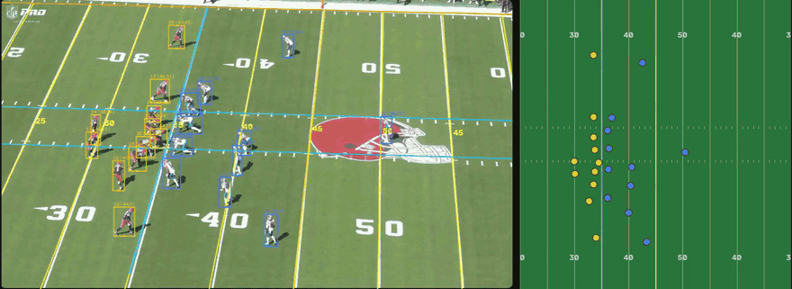
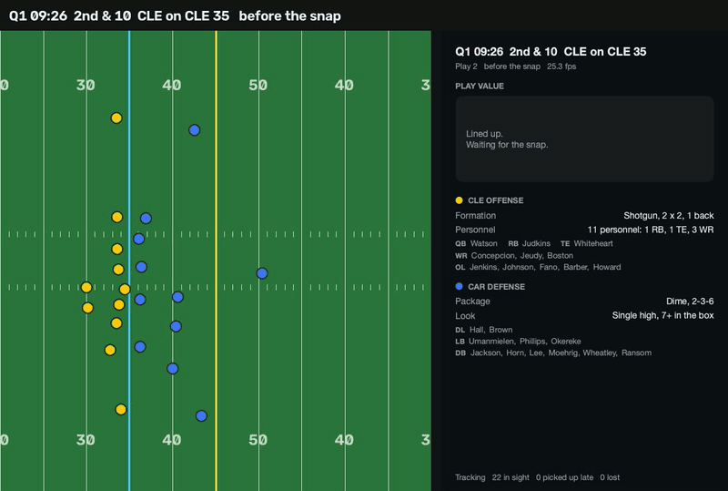
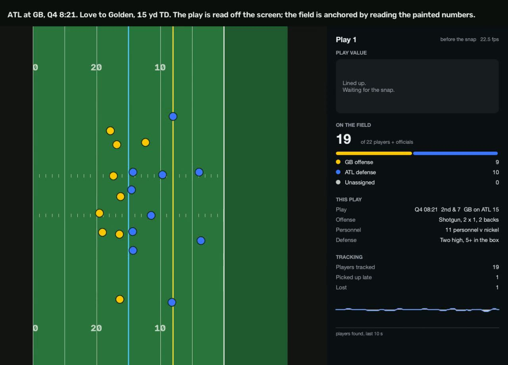
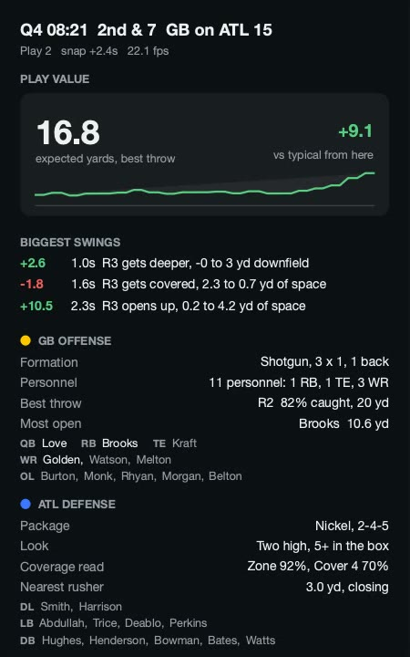
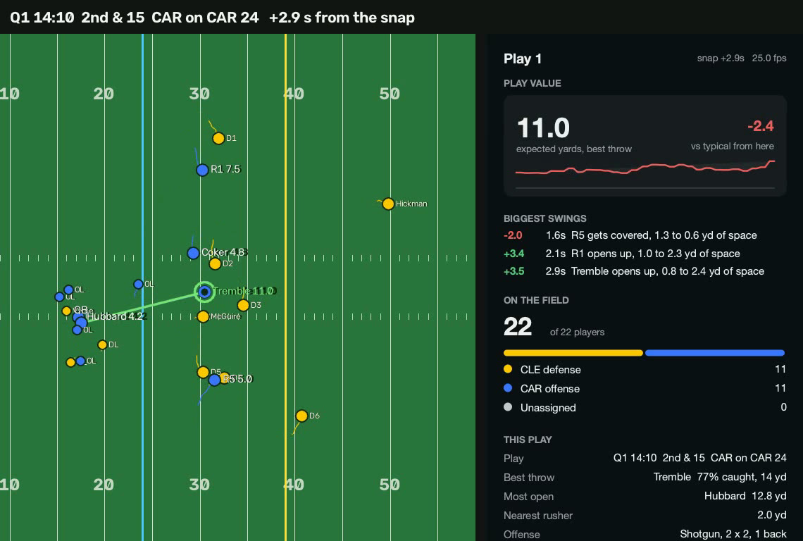
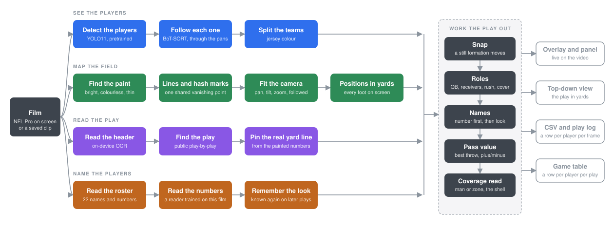

<h1 align="center">NFL Intelligence</h1>

<p align="center">
  <strong>Player tracking and a live pass value, read off NFL game film by a computer-vision pipeline.</strong>
</p>

<p align="center">
  
  
  
  
</p>

<p align="center">
  
</p>

<p align="center"><sub>Left, the film as the pipeline sees it: the fitted yard grid, a box on each player and his name. Right, the same moment drawn top-down in yards, with the best throw and its expected yards. Browns 2nd and 10, eight seconds from the snap.</sub></p>

---

The NFL tracks its players with chips in their shoulder pads and keeps the data to itself.
This project gets the same kind of picture from the broadcast film. Pointed at the All-22
player, it finds the players, maps the painted field to yards, reads the play off the screen,
names the players from their jersey numbers, finds the snap and the formation, and scores
every receiver on every frame with models trained on the league's own tracking data. It runs
live on a MacBook.

## Highlights

<table>
  <tr>
    <td align="center"><h3>17-18 fps</h3>4K capture with full analysis, Apple M5</td>
    <td align="center"><h3>45 / 45</h3>plays identified from the screen and matched to the play-by-play</td>
    <td align="center"><h3>36 / 40</h3>plays anchored to real yard lines by reading the painted numbers</td>
  </tr>
  <tr>
    <td align="center"><h3>39 / 42</h3>quarterbacks picked out at the snap, checked against official charting</td>
    <td align="center"><h3>36 / 36</h3>jersey numbers read right on held-out plays, checked by eye</td>
    <td align="center"><h3>AUC 0.76</h3>catch model on held-out weeks, calibrated within 3 points</td>
  </tr>
</table>

[docs/SHOWCASE.md](docs/SHOWCASE.md) gives the source of each number.

## What you see

<p align="center">
  
</p>
<p align="center"><sub>The same play with the panel. The play value climbs as receivers come open; the biggest swings are listed with the moment and the reason.</sub></p>

<table>
  <tr>
    <td width="62%"></td>
    <td></td>
  </tr>
  <tr>
    <td><sub>Before the snap. The play has been read off the screen and matched to the play-by-play, the field anchored from the painted numbers, and the formation and personnel are on the panel.</sub></td>
    <td><sub>Mid-play. Expected yards of the best throw, the plus/minus against a typical play from the same part of the field, who is open, the nearest rusher, and how the tracking is holding up.</sub></td>
  </tr>
</table>

<p align="center">
  
</p>
<p align="center"><sub>Panthers 2nd and 15. The names come from a jersey-number reader trained on this film, choosing among the 22 players the on-screen roster says are out there. A player named once is recognised on later plays by his look.</sub></p>

Each run also writes one table for the game, a row per player per play. From one half of
Panthers at Browns:

| team | name | # | role | plays | named by number / look | depth at snap (yd) | top speed (yd/s) | moments as best throw |
|---|---|---|---|---|---|---|---|---|
| CAR | Tremble | 82 | REC | 6 | 2 / 0 | -1.7 | 8.0 | 72 |
| CAR | Hubbard | 30 | REC | 8 | 1 / 0 | -5.4 | 8.4 | 14 |
| CAR | Moehrig | 7 | DEF | 7 | 2 / 5 | 5.5 | 10.2 | |
| CLE | Jeudy | 3 | REC | 4 | 2 / 2 | -1.7 | 8.7 | 26 |
| CLE | Hickman | 33 | DEF | 4 | 4 / 0 | 11.9 | 9.8 | |
| CLE | Verse | 8 | DL | 4 | 4 / 0 | 0.8 | 5.8 | |

## How it works

<p align="center">
  
</p>

1. A pretrained YOLO detector finds the players and BoT-SORT keeps an identity on each one
   through the camera's pans. Jersey colour splits the two teams.
2. The yard lines are found by their shared vanishing point and checked against the hash
   marks. A pan/tilt/zoom camera is fitted to them and followed frame to frame, so every
   foot on screen has a position in yards.
3. On-device text recognition reads the play header and the on-field roster. The header
   finds the play in the public play-by-play. The big painted numbers, whose arrows point at
   the nearer goal line, tie the yards to the real field.
4. The snap is a still formation starting to move. Each player gets a role from where he
   stands at that moment, corrected by what he does next.
5. A number reader trained on this film reads the torsos. A look memory recognises a named
   player on later plays by his build, sleeves, socks and gloves.
6. Catch and yards models trained on Big Data Bowl tracking score every receiver on every
   frame. The play value is the best throw available; the plus/minus compares it with a
   typical play at the same moment from the same part of the field.

[docs/REPO_GUIDE.md](docs/REPO_GUIDE.md) goes through the code file by file.

## Quick start

macOS on Apple silicon, Python 3.12, [uv](https://docs.astral.sh/uv/).

```bash
uv sync --all-groups
uv run nfl check                                              # weights, GPU, screen capture
uv run nfl data --season 2026                                 # public play-by-play, once
uv run nfl overlay --window "Chrome" --out outputs/live.csv   # live on a playing video
uv run nfl run data/clips/play.mp4 --topdown                  # or on a saved clip
```

[docs/USAGE.md](docs/USAGE.md) has the commands and flags, what each run writes, how to
train the models, and how to tell a run is working.

## Documentation

| | |
|---|---|
| [docs/USAGE.md](docs/USAGE.md) | Running it: commands, flags, outputs, training, how to tell it is working |
| [docs/STATUS.md](docs/STATUS.md) | Where each part stands, with its measured number |
| [docs/SHOWCASE.md](docs/SHOWCASE.md) | What it does and where each number comes from |
| [docs/REPO_GUIDE.md](docs/REPO_GUIDE.md) | Each file and how a play travels through them |
| [docs/PRIOR_ART.md](docs/PRIOR_ART.md) | What exists elsewhere and what was learned from it |
| [docs/BRIEF.md](docs/BRIEF.md) | The original scope |

## Built with

[Ultralytics YOLO11](https://github.com/ultralytics/ultralytics), BoT-SORT, PyTorch on
Apple MPS, OpenCV, Apple Vision for on-device OCR, PySide6, Polars, scikit-learn,
[NFL Big Data Bowl 2026](https://www.kaggle.com/competitions/nfl-big-data-bowl-2026-prediction) tracking data,
[nflverse](https://github.com/nflverse) play-by-play and FTN charting.

## Licence

MIT for the code. The film, the tracking data and the models made from them are outside the
repository and carry their own terms. The eight seconds of film at the top are from NFL Pro
and are shown here to demonstrate the software; the other pictures are drawn from the
pipeline's own output.
